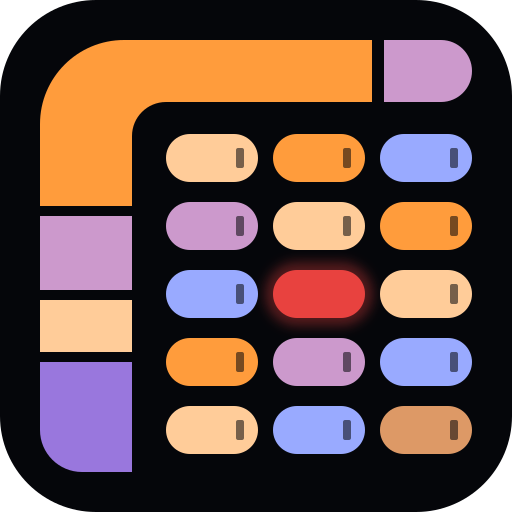
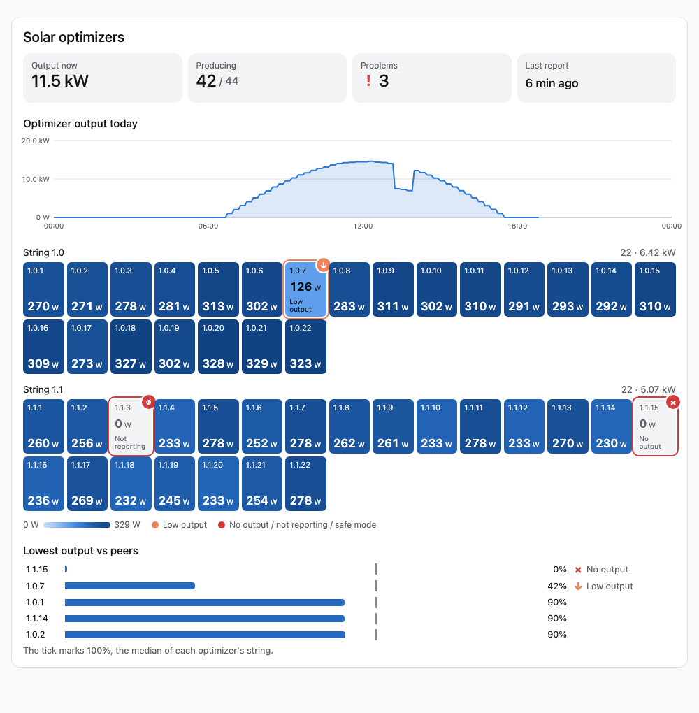

# SolarEdge Optimizers Card

A Home Assistant dashboard card for the
[SolarEdge Optimizers](https://github.com/SharperThanThou/SolarEdge-Optimizers)
integration. It shows every optimizer on your site at once:

- **Panel map.** One tile per optimizer, grouped by string and shaded by
  how much power it's producing. Optimizers with a health problem get a
  coloured ring, an icon and the problem written on the tile.
- **Summary.** Total optimizer output, how many optimizers are producing, how
  many have a problem, and when the portal last heard from the site.
- **Today's output.** Total optimizer power since midnight, from Home
  Assistant's history.
- **Lowest output vs peers.** The optimizers producing least compared with
  the median of their string, with 100% marked.

Hover over a tile or bar for its details, and click it to open the
optimizer's health entity.



The card needs no setup. It finds the optimizers through the integration, so
renamed entities, and optimizers added later, are picked up automatically.
Optimizers you've disabled (such as replaced units the portal still lists)
are left out.

## Installation

You need the SolarEdge Optimizers integration set up first.

### HACS (custom repository)

1. In HACS, open the menu and choose **Custom repositories**.
2. Add `https://github.com/SharperThanThou/SolarEdge-Optimizers-Card` as a
   **Dashboard** (called *Lovelace* or *Plugin* in older HACS versions).
3. Install **SolarEdge Optimizers Card**, then reload your browser.

### Manual

1. Copy `solaredge-optimizers-card.js` into `config/www/`.
2. **Settings → Dashboards → ⋮ → Resources → Add resource**, URL
   `/local/solaredge-optimizers-card.js`, type **JavaScript module**.
3. Reload your browser.

## Usage

Edit a dashboard, choose **Add card** and search for **SolarEdge
Optimizers**, or add it in YAML:

```yaml
type: custom:solaredge-optimizers-card
```

For a dashboard of its own, see [`examples/dashboard.yaml`](examples/dashboard.yaml).
It's a single-card *panel* view, so the map uses the full width.

### Options

| Option | Default | Description |
| --- | --- | --- |
| `title` | `Solar optimizers` | Card title. Set to `""` to hide it. |
| `show_history` | `true` | Show today's total output chart. |
| `show_weakest` | `5` | How many optimizers to list under *Lowest output vs peers*. `0` hides the list. |
| `max_power` | (highest current output) | Fix the power that gets the darkest shade, e.g. your optimizers' rated power. By default the shading is relative to the best optimizer right now. |
| `site` | (all sites) | Only show the site whose device name contains this text. |

## How it reads the data

The card uses the entities the integration creates for each optimizer:
Health, Output vs peers, Power, Module voltage and Last measurement. The map
shows the integration's confirmed health status, so a tile only turns red
after the integration's *consecutive bad samples* check agrees. The chart adds
up the optimizers' power history, so it needs the Recorder (on by default) and
only covers what Home Assistant has recorded since the integration was
installed.

The map's shading uses a single blue scale. Problems use orange (low output)
and red (no output, not reporting, stuck in safe mode), and always come with
an icon and a label, so they don't rely on colour alone.

## Development

The card is a single JavaScript file with no build step and no dependencies.
`demo/index.html` renders it outside Home Assistant with made-up data:

```bash
python3 -m http.server
# then open http://localhost:8000/demo/
# ?dark for the dark theme, ?night for an idle site, ?w=358 for phone width
```

## License

Apache License 2.0. See [LICENSE](LICENSE).
