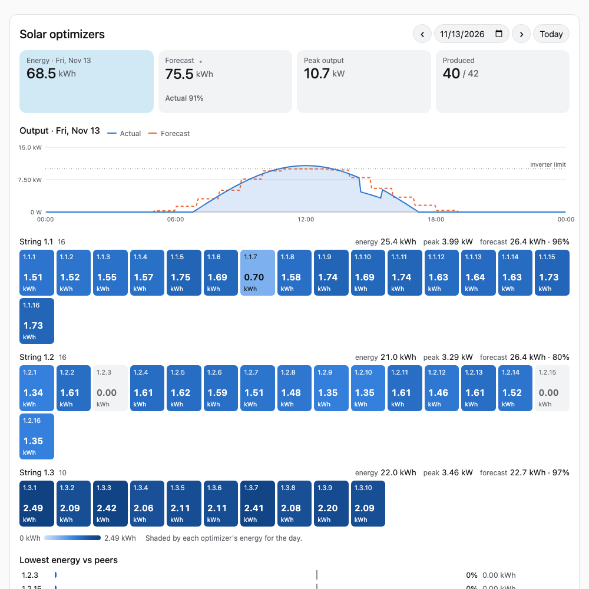
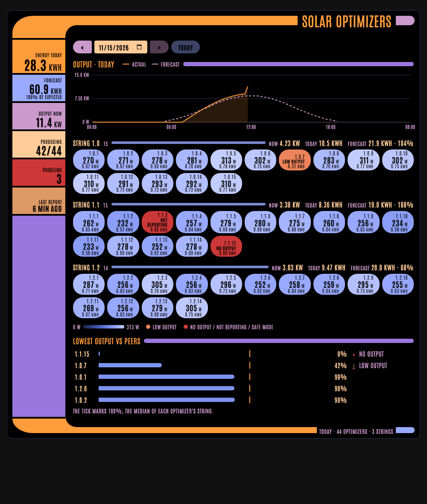

# SolarEdge Optimizers Card

A Home Assistant dashboard card for the
[SolarEdge Optimizers](https://github.com/SharperThanThou/SolarEdge-Optimizers)
integration. It shows every optimizer on your site at once:

- **Day navigator.** Step back through earlier days, pick one from the
  calendar, or jump back to today.
- **Summary.** Energy produced so far today, output now, how many optimizers
  are producing, how many have a problem, and when the portal last heard from
  the site. For an earlier day: its energy, peak output and how many
  optimizers produced anything.
- **Strings.** Each string's output now and energy so far, or for an earlier
  day its energy and peak.
- **Panel map.** One tile per optimizer, grouped by string. Today each tile
  shows its output now and its energy so far, shaded by output; for an
  earlier day it shows the day's total, shaded by energy. Optimizers with a
  health problem get a coloured ring, an icon and the problem written on the
  tile.
- **Predicted generation (optional).** A forecast for the site and for each
  string from Home Assistant's Forecast.Solar integration, with how much of
  it you've produced, and a dashed forecast line on the output curve.
- **Output curve.** The site's total optimizer output through the day.
- **Lowest output vs peers.** The optimizers producing least compared with
  the median of their string, with 100% marked. For an earlier day this
  compares each optimizer's energy instead.

Hover over a tile or bar for its details, and click it to open the
optimizer's health entity.



There's also an LCARS-inspired style (`style: lcars`), with an elbow frame,
sidebar readouts, pill-shaped optimizer buttons and a red-alert pulse on
faults:



The card needs no setup. It finds the optimizers through the integration, so
renamed entities, and optimizers added later, are picked up automatically.
Optimizers you've disabled (such as replaced units the portal still lists)
are left out.

## Installation

You need the SolarEdge Optimizers integration set up first.

### HACS (custom repository)

1. In HACS, open the menu and choose **Custom repositories**.
2. Add `https://github.com/SharperThanThou/SolarEdge-Optimizers-Card` as a
   **Dashboard** (called *Lovelace* or *Plugin* in older HACS versions).
3. Install **SolarEdge Optimizers Card**, then reload your browser.

### Manual

1. Copy `solaredge-optimizers-card.js` into `config/www/`.
2. **Settings → Dashboards → ⋮ → Resources → Add resource**, URL
   `/local/solaredge-optimizers-card.js`, type **JavaScript module**.
3. Reload your browser.

## Usage

Edit a dashboard, choose **Add card** and search for **SolarEdge
Optimizers**, or add it in YAML:

```yaml
type: custom:solaredge-optimizers-card
```

For a dashboard of its own, see [`examples/dashboard.yaml`](examples/dashboard.yaml).
It's a single-card *panel* view, so the map uses the full width.

### Options

| Option | Default | Description |
| --- | --- | --- |
| `title` | `Solar optimizers` | Card title. Set to `""` to hide it. |
| `style` | `default` | `default` follows your Home Assistant theme. `lcars` uses the LCARS-inspired black panel. |
| `lcars_font` | `true` | With `style: lcars`, load the Antonio typeface from Google Fonts. Set to `false` to make no external request; a condensed system font is used instead. |
| `show_history` | `true` | Show the output curve for the selected day. |
| `show_weakest` | `5` | How many optimizers to list under *Lowest output vs peers*. `0` hides the list. |
| `max_power` | (highest current output) | Fix the power that gets the darkest shade, e.g. your optimizers' rated power. By default the shading is relative to the best optimizer right now. |
| `site` | (all sites) | Only show the site whose device name contains this text. |
| `forecast` | `true` | Show predicted generation when Forecast.Solar is set up. `false` hides it. |
| `forecast_strings` | (none) | Which Forecast.Solar entry belongs to each string, by entry name or ID. See [step 4](#step-4-match-each-string-to-its-forecast). |

All of these can also be set in the card's visual editor.

## Predicted generation

The card can show how much your panels were expected to produce, next to what
they actually produced, for the whole site and for each string. The forecast
comes from Home Assistant's built-in
[Forecast.Solar](https://www.home-assistant.io/integrations/forecast_solar/)
integration.

**It needs an internet connection.** Home Assistant downloads the forecast
from forecast.solar, sending the location, tilt, direction and size you give
it. The card itself doesn't contact anything. Until a forecast is set up, the
card's *Forecast* figure says *Set up*; click it for a short explanation.

### How the pieces fit together

There are two kinds of names involved, and they come from different places:

- **String names** come from your SolarEdge site layout. The card shows them
  as the headings over each group of optimizers: *String 1.0*, *String 1.1*
  and so on. The name is the part after "String" (`1.0`). You can't change
  these; they're whatever the SolarEdge portal calls your strings.
- **Forecast names** are names you give your Forecast.Solar entries, such as
  *South roof*. Forecast.Solar creates entries without a name, so you rename
  them yourself (step 3).

Matching a string to a forecast tells the card "the panels in string 1.0 are
on the south roof, so compare them with the south roof forecast". Strings on
the same roof face can share one forecast.

### Before you start

For each roof face that has panels, note:

| | What it means | Example |
| --- | --- | --- |
| Strings | Which strings have panels on this face. In the card, hover over a panel tile to see its string. | 1.0 |
| Tilt | Angle of the panels from horizontal: 0° is flat, 90° is vertical. Most pitched roofs are 20–45°. | 30° |
| Direction | The compass direction the panels face: 0° north, 90° east, 180° south, 270° west. A compass app held flat against a panel, or your installer's design documents, will tell you. | 180° |
| Size | Total rated power of the panels on this face in watts: number of panels × each panel's rating. The rating is on the panel's label or your installation paperwork. | 15 × 310 W = 4650 W |

If one string covers two roof faces, use the face where most of its panels
are.

### Step 1: Add Forecast.Solar once per roof face

Do this once for each roof face, so three faces means three Forecast.Solar
entries. Each entry describes one face; the free plan allows one face per
entry.

1. Go to **Settings → Devices & services → Add integration** and choose
   **Forecast.Solar**
   ([shortcut](https://my.home-assistant.io/redirect/config_flow_start/?domain=forecast_solar)).
2. On the first screen keep **Enter fixed coordinates**, **Enter a fixed
   tilt** and **Enter a fixed direction**, and continue.
3. On the next screen:
   - **Location** is filled in with your home's location. Leave it, or move
     the pin onto your roof.
   - **Declination**: the tilt.
   - **Azimuth**: the direction.
   - **Total Watt peak power of your solar modules**: the size in watts.
4. Submit, then repeat for the next roof face.

### Step 2: Check the forecasts are working

Open **Settings → Devices & services → Forecast.Solar**. Each entry has a
*Solar production forecast* device with sensors such as *Estimated energy
production - today*. During the day these should show sensible numbers within
a few minutes.

### Step 3: Name each entry after its roof face

Forecast.Solar lists new entries without a name, which makes them hard to
tell apart. On the Forecast.Solar page, each entry has its roof face listed
underneath as tilt / direction / size, such as *30° / 180° / 4650W*, so you
can tell which is which. Choose **⋮** next to an entry, then **Rename**, and
name it after its roof face, such as *South roof*.

If you skip this, the card's editor still lists unnamed entries by their tilt
/ direction / size, but names are clearer, and the Energy dashboard (step 5)
only shows names.

### Step 4: Match each string to its forecast

**With the editor:** open the dashboard, choose **Edit dashboard**, then edit
this card. Under **Predicted generation** there's a list for every string;
choose the entry for the roof face that string is on, and save.

**Or in YAML:** each line is `"<string name>": <forecast name>`.

```yaml
type: custom:solaredge-optimizers-card
forecast_strings:
  "1.0": South roof
  "1.1": West roof
  "1.2": East roof
```

- The string name must match the card's heading exactly (`1.0` for *String
  1.0*). Keep the quotes: without them YAML reads `1.0` as the number 1.
- The forecast name must match the entry's name, ignoring capitals. The editor
  saves the entry's ID instead of its name, so renaming the entry later
  doesn't break it.
- Strings you leave out simply have no forecast.
- If you don't match any strings, the card adds up every Forecast.Solar entry
  and shows only a site forecast. That's the right choice if you have a single
  entry for the whole system.

### Step 5 (optional): Show the rest of today's forecast on the chart

Steps 1–4 give you every forecast figure. This step only adds the part of
today's dashed forecast line that's still ahead. Home Assistant only shares the
full day's forecast through the Energy dashboard, so without this step the line
stops at the current time.

You can only do this if Home Assistant already has an energy sensor for your
solar production, such as *Lifetime energy* from Home Assistant's own SolarEdge
integration or your inverter's Modbus integration. The SolarEdge Optimizers
integration doesn't provide one.

1. Go to **Settings → Dashboards → Energy**.
2. Under **Solar panels**, edit your existing solar production, or choose
   **Add solar production** and pick your solar energy sensor as **Solar
   production energy**.
3. In the **Solar production forecast** section of the same dialog, tick every
   Forecast.Solar entry the card uses. They're listed by the names from
   step 3.
4. Save, then reload the dashboard with the card.

This also adds a forecast to Home Assistant's own Energy dashboard.

### What you'll see

- **Forecast**, next to the day's energy: the forecast total for the day.
  - Today, with how much you've produced so far as a percentage of what the
    forecast expected *by now*, such as *96% of expected*.
  - For an earlier day, the day's total as a percentage of that day's forecast,
    such as *Actual 92%*.
- **In each string's heading**: *forecast 21.9 kWh · 104%*, the same
  comparison for that string. A string that's well under its own forecast on a
  clear day, while the others are close to theirs, is worth a look.
- **A dashed forecast line** on the output curve. Hover over the chart to
  compare actual and forecast at any time.
- **Click Forecast** to see which forecast each string uses.

Forecasts are approximate: Forecast.Solar doesn't see local cloud, shading or
dirty panels. Compare strings against their forecast over several days rather
than reading much into a single cloudy one.

Earlier days only have a forecast from when you set Forecast.Solar up, because
the card uses what Home Assistant recorded at the time.

On the free Forecast.Solar plan, Home Assistant refreshes each entry once an
hour. Forecast.Solar limits free requests per hour, and a few entries stay well
within it.

### Troubleshooting

| What you see | Why, and what to do |
| --- | --- |
| *Forecast: Set up* | No Forecast.Solar entries were found. Do step 1, then reload the page. |
| A string has no *forecast* in its heading | It isn't matched. Check step 4: the string name is quoted and matches the heading. |
| Forecast is *–* | The entry's sensors aren't reporting yet, or Home Assistant can't reach forecast.solar. Check the entry on the Forecast.Solar page. |
| The dashed line stops at the current time | Expected without step 5. |
| Percentages look far off for one string | Check that string's entry: tilt, direction and especially size. A wrong size shifts the percentage in proportion. |
| "Add plane" asks for an API key | Each entry is one roof face on the free plan. Add another entry instead (step 1). |


## How it reads the data

The card uses the entities the integration creates for each optimizer:
Health, Output vs peers, Power, Module voltage and Last measurement. The map
shows the integration's confirmed health status, so a tile only turns red
after the integration's *consecutive bad samples* check agrees. Health is
only known for the present, so earlier days show energy without problem
markers.

### Energy

The integration reports power, not energy, so the card works energy out from
the power statistics Home Assistant's Recorder keeps for every power sensor.
These are five-minute averages, which it adds up over the day. That has a few
consequences:

- **It's an estimate.** The portal only updates each optimizer every few
  minutes, so energy is accurate to a few percent, not to the watt-hour. For
  billing-grade numbers use your inverter's or meter's energy sensor.
- **History starts when you installed the integration.** Earlier days show
  no data.
- **Older days are hourly.** Five-minute statistics are kept as long as the
  Recorder keeps history (10 days by default). After that the card uses the
  hourly statistics, which are kept indefinitely: the totals stay the same but
  the curve is coarser.
- **Today trails slightly.** Statistics are compiled every five minutes, so
  the card adds the current reading for the last few minutes.
- **Days follow your browser's time zone.**

The Recorder needs to be running (it is by default) and must not exclude the
optimizers' power sensors.

The map's shading uses a single blue scale. Problems use orange (low output)
and red (no output, not reporting, stuck in safe mode), and always come with
an icon and a label, so they don't rely on colour alone. The LCARS style
keeps the same meaning: blue shading for power, orange and red buttons for
problems, with the problem written on the button. Its red-alert pulse stops
if your device is set to reduce motion.

## Development

The card is a single JavaScript file with no build step and no dependencies.
`demo/index.html` renders it outside Home Assistant with made-up data:

```bash
python3 -m http.server
# then open http://localhost:8000/demo/
# ?dark for the dark theme, ?night for an idle site, ?w=358 for phone width,
# ?lcars for the LCARS style, ?day=-1 for yesterday (combine with &)
```

## License

Apache License 2.0. See [LICENSE](LICENSE).
